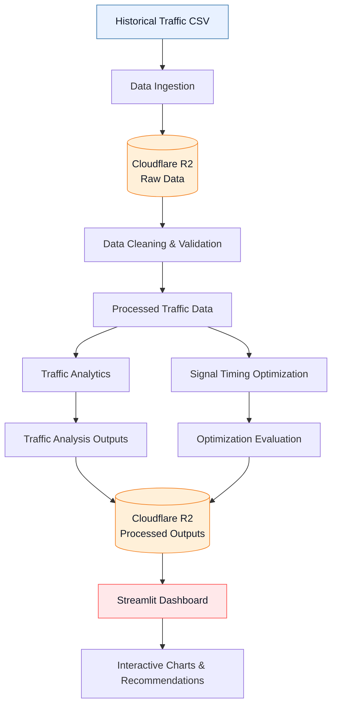

[](https://smart-traffic-optimization.streamlit.app/)
[](https://www.python.org/)
[](https://streamlit.io/)
[](https://developers.cloudflare.com/r2/)
[](https://pandas.pydata.org/)

# Smart Traffic Optimization System

A cloud-based traffic analytics and signal-timing recommendation system built using Python, Streamlit, and Cloudflare R2.

**Live Demo:** https://smart-traffic-optimization.streamlit.app/

**Repository:** https://github.com/kashvishetty2410/smart-traffic-optimization

## Overview

The Smart Traffic Optimization System analyzes historical traffic data to identify traffic patterns, compare junction-level demand, and generate prototype traffic signal timing recommendations.

The system combines a Python-based data processing pipeline with cloud object storage and an interactive Streamlit dashboard. Users can explore traffic patterns by hour, compare junctions, examine congestion-related indicators, and evaluate proposed signal timings against a baseline.

## Dashboard Preview

### Traffic Overview


### Signal Optimization


### Detailed Analytics


## Key Features

- **Traffic data processing:** Clean and validate historical traffic records.
- **Traffic analytics:** Analyze hourly traffic, junction-level demand, and weekday patterns.
- **Congestion analysis:** Explore traffic demand patterns using historical vehicle counts.
- **Signal timing recommendations:** Generate demand-based prototype green-time recommendations for different junctions and hours.
- **Optimization evaluation:** Compare baseline and optimized proxy scores.
- **Cloud storage:** Store raw and processed datasets in Cloudflare R2.
- **Interactive dashboard:** Explore analytics and optimization outputs using Streamlit and Plotly.
- **Multiple data sources:** Load dashboard data from Cloudflare R2 or local processed files.

## Technology Stack

| Component | Technology |
|---|---|
| Programming language | Python |
| Data processing | Pandas |
| Visualization | Plotly, Matplotlib |
| Dashboard | Streamlit |
| Cloud object storage | Cloudflare R2 |
| Cloud storage access | Boto3 |
| Configuration | python-dotenv |
| Version control | Git and GitHub |

## System Architecture



## Dataset

The project uses a historical traffic prediction dataset containing vehicle counts recorded at multiple junctions over time.

**Dataset:** [Traffic Prediction Dataset on Kaggle](https://www.kaggle.com/datasets/fedesoriano/traffic-prediction-dataset)

The processed dataset used during validation contained:

- **48,120** traffic records
- **4** junctions
- Timestamp, junction identifier, vehicle count, and record identifier fields
- Historical observations spanning November 2015 to June 2017

The data is historical and does not represent live traffic sensor feeds.

## Project Workflow

### 1. Data ingestion and cleaning

Traffic data is ingested from CSV files and validated for missing values, duplicate records, invalid timestamps, and invalid vehicle counts. The cleaned dataset is saved for downstream processing.

### 2. Traffic analytics

The analytics pipeline generates insights including:

- Average traffic by hour
- Traffic demand by junction
- Weekday traffic patterns
- Congestion-related demand analysis
- Junction-hour traffic profiles

### 3. Signal timing optimization

The optimization module uses historical hourly vehicle demand to calculate prototype green-time recommendations.

The system evaluates candidate green times against a baseline proxy score. The proxy measures alignment between a selected green duration and a demand-derived target; it is not a direct measurement of traffic delay or queue length.

### 4. Cloud storage

Cloudflare R2 stores the raw dataset and generated outputs. The application retrieves the required processed files through Boto3.

### 5. Interactive dashboard

The Streamlit dashboard presents traffic KPIs, hourly trends, junction comparisons, weekday patterns, and signal optimization results. Users can filter the analysis by junction and switch between cloud and local data sources.

## Initial Validation Results

| Metric | Observed result |
|---|---:|
| Traffic records | 48,120 |
| Junctions | 4 |
| Overall average vehicles per record | 22.79 |
| Busiest average hour | 19:00 |
| Hourly optimization profiles | 96 |
| Profiles with lower proxy scores | 87 |
| Profiles with unchanged proxy scores | 9 |

The optimization evaluation reported lower or unchanged proxy scores for all evaluated profiles. This is an outcome of the prototype's candidate-selection method and should not be interpreted as proof of reduced real-world congestion.

## Getting Started

### Prerequisites

- Python 3.11
- Git
- A Cloudflare R2 bucket and API credentials if using cloud storage

### 1. Clone the repository

```bash
git clone https://github.com/kashvishetty2410/smart-traffic-optimization.git
cd smart-traffic-optimization
```

### 2. Create and activate a virtual environment

On Windows PowerShell:

```powershell
py -3.11 -m venv .venv
.\.venv\Scripts\Activate.ps1
```

### 3. Install dependencies

```powershell
python -m pip install -r requirements.txt
```

### 4. Configure Cloudflare R2

Create a local `.env` file in the project root:

```dotenv
R2_ACCOUNT_ID=your_account_id
R2_ACCESS_KEY_ID=your_access_key_id
R2_SECRET_ACCESS_KEY=your_secret_access_key
R2_BUCKET_NAME=smart-traffic-data
```

Replace the placeholder values with your own credentials. Never commit `.env` or publish API secrets.

The dashboard expects the required processed CSV files to exist in the configured R2 bucket when Cloudflare R2 is selected.

### 5. Run the dashboard

```powershell
python -m streamlit run dashboard/app.py
```

Streamlit will provide a local URL in the terminal.

### 6. Run the cloud processing pipeline

After configuring R2 and uploading the raw dataset to the expected location, run:

```powershell
python src/run_cloud_pipeline.py
```

The pipeline downloads the raw traffic data from R2, runs the cleaning, analysis, and optimization scripts, and uploads the generated outputs back to R2.

### 7. Run the optimization tests

```powershell
python -m unittest tests.test_signal_optimization -v
```

## Repository Structure

```text
smart-traffic-optimization/
├── dashboard/
│   └── app.py
├── src/
│   ├── data_cleaning.py
│   ├── traffic_analysis.py
│   ├── signal_optimization.py
│   ├── run_cloud_pipeline.py
│   ├── r2_connection_test.py
│   ├── r2_download_test.py
│   ├── r2_list_files.py
│   └── r2_upload_files.py
├── tests/
│   └── test_signal_optimization.py
├── data/
│   ├── raw/
│   └── processed/
├── .gitignore
└── requirements.txt
```

Generated data files are created during processing and are not required to be committed to GitHub.

## Deployment

The dashboard is deployed using Streamlit Community Cloud and reads processed data from Cloudflare R2.

**Live application:** https://smart-traffic-optimization.streamlit.app/

Cloud credentials are configured through deployment secrets rather than being stored in the repository.

## Limitations

- The system analyzes historical observations rather than live traffic feeds.
- Vehicle counts alone do not describe complete intersection conditions.
- The prototype does not directly model queue lengths, turning movements, pedestrian phases, actual signal states, or measured vehicle delays.
- Proxy-score improvement does not establish real-world traffic or emissions reduction.
- The recommendations require validation using richer traffic data, realistic signal constraints, and simulation or field testing before operational use.

## Future Scope

- Integrate live traffic sensors or real-time traffic feeds.
- Incorporate queue length, turning movement, and signal-phase information.
- Evaluate recommendations using traffic simulation software.
- Compare alternative optimization algorithms.
- Add automated data refresh and pipeline monitoring.
- Introduce model evaluation and reproducible experiment reports.

## Author

Developed as an academic project exploring cloud-based traffic analytics and prototype signal timing optimization.

